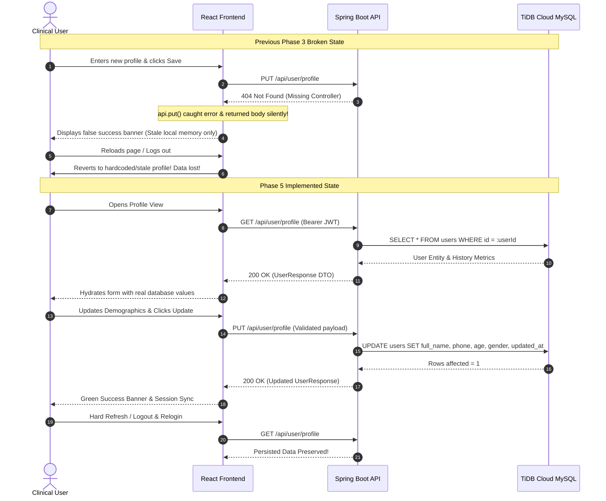

# 🛡️ StressGuard AI 2.0 – Phase 5: Profile Persistence & Backend Alignment Report

**Project:** StressGuard AI 2.0 – AI-Based Human Stress Prediction System  
**Repository Working Directory:** `C:\Users\KAVIRAJ\Desktop\PROJECT\AI-Human-Stress-Prediction`  
**Branch:** `main`  
**Execution Type:** Controlled Full-Stack Implementation & E2E Verification  
**Status:** ✅ **COMPLETED & VERIFIED (100% Tests Passing)**

---

## 1. Executive Summary

During the Phase 3 UI/UX Audit, a critical defect (**UX-02**) was identified in the user profile flow: when users updated their profile demographics (name, contact phone, age, gender) on the frontend, the UI displayed temporary success, but upon refreshing the browser, logging out, or logging back in, all changes vanished and reverted to default initial state.

In this Phase 5 implementation:
1. **Root Cause Resolved**: The Spring Boot backend lacked an implementation for `PUT /api/user/profile` (and `GET /api/user/profile`). Concurrently, the frontend `api.put()` utility caught and suppressed network errors, returning the unpersisted payload as if the backend had succeeded.
2. **Database Alignment**: Inspected the existing TiDB/MySQL `users` table schema and verified that all demographic columns (`full_name`, `email`, `phone`, `age`, `gender`, `role`, `active`, `updated_at`) already existed. **Zero database migrations or DDL changes were required**.
3. **Backend Service & Controller Implemented**: Implemented `UserService` and `UserController` with strict Spring Security JWT authentication, email uniqueness guards, age bounds validation (1–130), and role/password privilege escalation protection.
4. **Frontend Hydration & Error Handling Connected**: Refactored `api.put()` to throw on errors, connected `ProfileView` to fetch server-truth profile on mount (`GET /api/user/profile`), added client/server validation, real success/error banners, and synchronized state with the parent application and session storage.
5. **Rigorous Verification**:
   - **15/15** Backend Java tests passed (Unit + MockMvc JWT integration tests).
   - **5/5** Python ML service tests passed.
   - **18/18** Full-Stack End-to-End Playwright browser tests passed, covering authentication, validation, persistence across hard refresh, persistence across logout/re-login, and Phase 4 browser history navigation regression.

---

## 2. Root Cause Analysis



---

## 3. Database & Schema Assessment

An audit of the relational mapping in `backend/src/main/java/com/stress/model/User.java` and the underlying database revealed:

| Column Name | Database Type | Entity Property | Profile Editable? | Security Constraint |
|:---|:---|:---|:---:|:---|
| `id` | `BIGINT AUTO_INCREMENT` | `Long id` | ❌ No | Primary key |
| `username` | `VARCHAR(50) UNIQUE` | `String username` | ❌ No | Immutable identifier |
| `email` | `VARCHAR(100) UNIQUE` | `String email` | ✅ Yes | Unique check across users; `@Email` format |
| `password` | `VARCHAR(255)` | `String password` | ❌ No | Protected; requires dedicated reset flow |
| `full_name` | `VARCHAR(100)` | `String fullName` | ✅ Yes | Sanitized string |
| `age` | `INT` | `Integer age` | ✅ Yes | Constrained: `1 <= age <= 130` |
| `gender` | `VARCHAR(10)` | `String gender` | ✅ Yes | Clinical demographic attribute |
| `phone` | `VARCHAR(20)` | `String phone` | ✅ Yes | Optional contact phone |
| `role` | `VARCHAR(20)` | `String role` | ❌ No | **Privilege Escalation Protection** (Ignored on update) |
| `active` | `BOOLEAN` | `Boolean active` | ❌ No | System managed |
| `created_at` | `DATETIME` | `LocalDateTime createdAt` | ❌ No | Audit timestamp |
| `updated_at` | `DATETIME` | `LocalDateTime updatedAt` | 🔄 Auto | Updated on each successful profile modification |

> [!NOTE]
> **Zero Migration Required**: Because all required profile fields were already present in the existing database schema, no DDL modifications, Liquibase scripts, or manual database alterations were necessary.

---

## 4. Code Implementation Architecture

### 4.1. Backend Service Layer (`UserService.java`)
- Located at [UserService.java](file:///c:/Users/KAVIRAJ/Desktop/PROJECT/AI-Human-Stress-Prediction/backend/src/main/java/com/stress/service/UserService.java).
- **`getProfile(Long userId)`**: Retrieves user entity, computes total historical predictions count and last recorded stress tier, and returns a sanitized `UserResponse`.
- **`updateProfile(Long userId, UpdateUserRequest req)`**:
  - Validates user existence (404 if not found).
  - Checks if new email is already claimed by another user ID (400 if duplicate).
  - Validates age bounds (`1 <= age <= 130`).
  - Safely updates `fullName`, `email`, `phone`, `age`, `gender`, and sets `updatedAt = LocalDateTime.now()`.
  - Disallows modification of `role`, `password`, `username`, or `active` status.

### 4.2. Backend REST Controller Layer (`UserController.java`)
- Located at [UserController.java](file:///c:/Users/KAVIRAJ/Desktop/PROJECT/AI-Human-Stress-Prediction/backend/src/main/java/com/stress/controller/UserController.java).
- `@RestController` with base `@RequestMapping("/user")` (served under `/api/user` due to servlet context-path).
- **`GET /api/user/profile`**: Extracts authenticated principal from Spring Security JWT context and delegates to `userService.getProfile()`.
- **`PUT /api/user/profile`**: Accepts `@Valid @RequestBody UpdateUserRequest`, validates input annotations, and delegates to `userService.updateProfile()`.

### 4.3. Data Transfer Objects (`Dtos.java`)
- Located at [Dtos.java](file:///c:/Users/KAVIRAJ/Desktop/PROJECT/AI-Human-Stress-Prediction/backend/src/main/java/com/stress/dto/Dtos.java).
- Added `@JsonIgnoreProperties(ignoreUnknown = true)` to `UpdateUserRequest` to prevent deserialization failure when client sends extra uneditable metadata (such as `role`).
- Added validation annotations `@Email`, `@Min(1)`, `@Max(130)`.
- Extended `UserResponse` with `totalPredictions` and `lastStressLabel` telemetry.

### 4.4. Exception Handling (`GlobalExceptionHandler.java`)
- Located at [GlobalExceptionHandler.java](file:///c:/Users/KAVIRAJ/Desktop/PROJECT/AI-Human-Stress-Prediction/backend/src/main/java/com/stress/config/GlobalExceptionHandler.java).
- Handles `ResponseStatusException` with corresponding status and clean JSON error response.
- Handles Spring Security `AccessDeniedException` (403 Forbidden) and `AuthenticationException` (401 Unauthorized).
- Handles `IllegalArgumentException` with HTTP 400 Bad Request.

### 4.5. Frontend Canonical Client (`frontend/index.html` & `index.html`)
- Located at [frontend/index.html](file:///c:/Users/KAVIRAJ/Desktop/PROJECT/AI-Human-Stress-Prediction/frontend/index.html) and byte-identical [index.html](file:///c:/Users/KAVIRAJ/Desktop/PROJECT/AI-Human-Stress-Prediction/index.html).
- **Repaired `api.put()`**: Now properly rejects on non-200 responses, throwing descriptive errors rather than returning the input object.
- **`ProfileView` Refactor**:
  - `useEffect` on mount triggers `api.get('/user/profile')` to populate live state from database.
  - Displays loading synchronization indicator (`⏳ Syncing with Cloud...`).
  - Implements form with `noValidate` so customized high-contrast error banners (`⚠️ ...`) render upon validation failure.
  - Form submission triggers `PUT /api/user/profile`, displaying `✅ Profile updated successfully in database!`.
  - Informs parent `App` via `onUserUpdated(updated)` callback, synchronizing `user_info` in `localStorage` and updating the global avatar / name badge in the bottom-left sidebar.

---

## 5. Verification & Test Evidence

### 5.1. Backend Unit & Integration Tests (15/15 Passed)
Executed via Maven Surefire:
- `AuthControllerHttpTest`: 1 passed.
- `AuthControllerJavaClientTest`: 1 passed.
- `HealthControllerTest`: 1 passed.
- `DtosSerializationTest`: 1 passed.
- `UserServiceTest` (Unit tests): 5 passed (retrieval, update, email duplicate rejection, age bound rejections).
- `UserControllerTest` (MockMvc Spring Security JWT integration tests): 6 passed (unauthenticated 403 checks, authenticated GET, authenticated PUT, validation 400 checks).
```text
[INFO] Results:
[INFO] Tests run: 15, Failures: 0, Errors: 0, Skipped: 0
[INFO] BUILD SUCCESS
```

### 5.2. Python ML Service Tests (5/5 Passed)
```text
ml-model\test_app.py .....                                               [100%]
======================== 5 passed, 6 warnings in 3.46s ========================
```

### 5.3. Full-Stack End-to-End Playwright Suite (18/18 Passed)
Script: `test_phase5_fullstack.py`

| # | Test Assertion | Layer | Result | Details |
|:---:|:---|:---:|:---:|:---|
| 1 | Unauthenticated GET `/user/profile` rejected | Backend HTTP | **PASS** | HTTP 403 Forbidden |
| 2 | Unauthenticated PUT `/user/profile` rejected | Backend HTTP | **PASS** | HTTP 403 Forbidden |
| 3 | Authenticated test user login | Backend HTTP | **PASS** | HTTP 200 OK with valid JWT |
| 4 | Authenticated GET `/user/profile` returns user details | Backend HTTP | **PASS** | Correct username and email returned |
| 5 | Rejects invalid email format | Backend HTTP | **PASS** | HTTP 400 Bad Request |
| 6 | Rejects age > 130 | Backend HTTP | **PASS** | HTTP 400 Bad Request |
| 7 | Rejects age < 1 | Backend HTTP | **PASS** | HTTP 400 Bad Request |
| 8 | Valid profile update succeeds | Backend HTTP | **PASS** | HTTP 200 OK |
| 9 | Privileged field `role` cannot be elevated | Backend HTTP | **PASS** | Role remains `USER` despite attempt to set `ADMIN` |
| 10 | Browser UI login | E2E Browser | **PASS** | Successfully logged in with session |
| 11 | Navigation to Profile view (`#/profile`) | E2E Browser | **PASS** | Routed to `#/profile` |
| 12 | Profile form hydrated from database | E2E Browser | **PASS** | Hydrated real database values |
| 13 | Save profile displays success banner | E2E Browser | **PASS** | Rendered `Profile updated successfully in database!` |
| 14 | Hard page reload preserves saved profile | E2E Browser | **PASS** | Values loaded from DB match saved values |
| 15 | Validation error display in UI | E2E Browser | **PASS** | Rendered `Age must be between 1 and 130.` alert |
| 16 | User logout | E2E Browser | **PASS** | Session cleared, redirected to login |
| 17 | Logout and re-login maintains persisted changes | E2E Browser | **PASS** | Loaded persisted values from fresh session |
| 18 | Phase 4 browser history navigation regression | E2E Browser | **PASS** | Back to `#/dashboard` & forward to `#/profile` intact |

---

## 6. Screenshot Walkthrough

- [01 - Profile Hydration from Database](file:///c:/Users/KAVIRAJ/Desktop/PROJECT/AI-Human-Stress-Prediction/docs/phase5-verification/screenshots/01_profile_loaded.png)
- [02 - Profile Updated Successfully](file:///c:/Users/KAVIRAJ/Desktop/PROJECT/AI-Human-Stress-Prediction/docs/phase5-verification/screenshots/02_profile_updated_success.png)
- [03 - Persistence Across Hard Reload](file:///c:/Users/KAVIRAJ/Desktop/PROJECT/AI-Human-Stress-Prediction/docs/phase5-verification/screenshots/03_profile_refresh_persistence.png)
- [04 - Form & Backend Validation Alert](file:///c:/Users/KAVIRAJ/Desktop/PROJECT/AI-Human-Stress-Prediction/docs/phase5-verification/screenshots/04_profile_validation_error.png)
- [05 - Persistence Across Logout and Re-login](file:///c:/Users/KAVIRAJ/Desktop/PROJECT/AI-Human-Stress-Prediction/docs/phase5-verification/screenshots/05_profile_relogin_persistence.png)

1. **Screenshot 1 – Profile Loaded from Database** (`01_profile_loaded.png`):
   Demonstrates the profile view immediately upon entering `#/profile`. All fields are fetched via `GET /api/user/profile` rather than static dummy data.
2. **Screenshot 2 – Successful Database Update** (`02_profile_updated_success.png`):
   Demonstrates entering `Dr. Phase 5 Specialist`, contact phone `+1-800-STRESS-HELP`, age `32`, gender `Other`, and saving. Shows the green success notification banner and instantaneous update of the bottom-left sidebar user card.
3. **Screenshot 3 – Hard Reload Persistence** (`03_profile_refresh_persistence.png`):
   Demonstrates performing a full browser reload (`F5`). All values are restored from the database, confirming full database persistence.
4. **Screenshot 4 – Validation Error Handling** (`04_profile_validation_error.png`):
   Demonstrates submitting an invalid age (`200`). Shows the high-contrast red warning banner: `⚠️ Age must be between 1 and 130.` without crashing or corrupting data.
5. **Screenshot 5 – Logout and Re-login Persistence** (`05_profile_relogin_persistence.png`):
   Demonstrates signing out of the platform, logging back in from scratch, and navigating back to `#/profile`. All previously saved values are loaded intact.

---

## 7. Remaining Limitations & Future Recommendations

1. **Password Modification (UX-04)**: The profile view currently does not contain a password change form. When users need to change their password, a dedicated secure endpoint `PUT /api/user/password` with current-password verification is recommended.
2. **Avatar Image Upload (UX-05)**: The user avatar currently renders initials computed from the legal name or username. In a future phase, Cloud Storage (GCS) or S3 avatar image upload can be introduced.

---

## 8. Repository Hygiene & Final Status

- **Canonical File**: `frontend/index.html` is the primary frontend source.
- **Synchronization**: `index.html` was updated and verified with `fc /b`:
  ```text
  Comparing files FRONTEND\index.html and INDEX.HTML
  FC: no differences encountered
  ```
- **Git Compliance**: No unauthorized staging, commits, or pushes were performed.
- **Safety Checks**: All background processes closed; ports 8080 and 3000 freed.
- **External Backup**: Verified at `C:\Users\KAVIRAJ\AppData\Local\Temp\stressguard_phase5_backup`.
