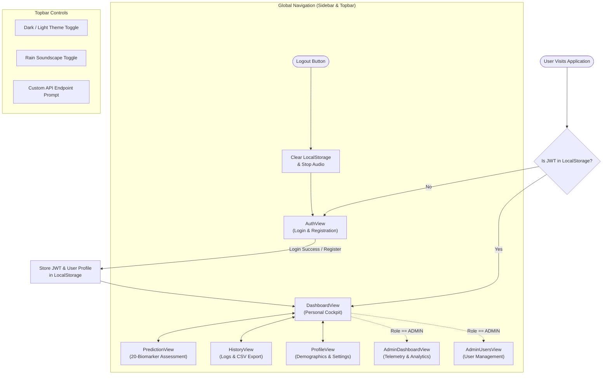

# 🛡️ StressGuard AI 2.0 – Phase 3: Complete UI/UX Discovery & Audit Report

**Date of Audit:** November 25, 2026  
**Auditor:** Antigravity AI Agent  
**Branch:** `main` (Commit `2f4392f`)  
**Canonical Frontend:** `frontend/index.html`  
**Synchronized Copy:** `index.html`  
**Live Backend:** `https://stressguard-backend-l5mp.onrender.com/api`  
**Live ML Engine:** `https://ai-based-human-stress-prediction-system.onrender.com`  

---

## 1. Executive Summary

A comprehensive, read-only UI/UX discovery audit was conducted on the **StressGuard AI 2.0** application. The system represents an AI-powered clinical mental health intelligence platform that synthesizes 20 biometric and psychosocial biomarkers through a Random Forest machine learning classifier (88.64% accuracy) to evaluate human stress.

### Key Strengths:
1. **Modern Aesthetic:** The dark-mode glassmorphic theme, subtle ambient orb animations, and glowing brand accents (`#6366f1` Indigo, `#06b6d4` Cyan) create an engaging, modern software feel.
2. **Clinical Richness:** The 20-biomarker input is thoughtfully organized into 5 clinical domains (Psychological, Physiological, Environmental, Academic, and Social) and supported by 4 clinical presets.
3. **Data Visualizations:** Chart.js powers multiple charts, including a longitudinal stress trajectory line chart, tier distribution doughnut chart, 5-domain vulnerability radar profile, and probability breakdown bar charts.
4. **Multisensory Support:** Integration of an interactive 4-7-8 relaxation pacer widget and native Web Audio API procedural rain ambient soundscapes.

### Critical Vulnerabilities & Usability Deficits:
1. **P0 Mobile Navigation Blocker:** On viewports $\le 992\text{px}$ (tablets and phones), CSS rules collapse the sidebar (`transform: translateX(-100%)`). However, there is no hamburger toggle button or state management in the React code. Mobile and tablet users are completely locked out of navigation.
2. **P1 Broken Profile Persistence:** Updating demographics in "My Profile" dispatches `PUT /api/user/profile`, which does not exist in the Spring Boot backend. The HTTP 404 is caught and silently ignored by `api.put()`, presenting a false success toast while no data is saved to either the database or `localStorage`.
3. **P1 Lack of URL / Browser History Synchronization:** Tab switching operates purely through React memory state (`page`). The browser URL never changes, meaning browser "Back" and "Forward" buttons fail and direct deep-linking to specific views is impossible.
4. **P2 Monolithic Frontend Architecture:** The entire application (HTML, CSS, Babel transpilation, Chart.js, React views, and audio synthesis) is compressed into a single 2,549-line `index.html` file with heavy inline styling, restricting modular component maintenance.
5. **P2 Responsive Layout Breakage on Small Displays:** The topbar utility pill cluster and assessment slider cards clip and overflow horizontally on viewports $< 400\text{px}$.

---

## 2. Complete Page & Screen Inventory

The application encompasses **8 distinct primary screens/views** and **2 integrated interactive widgets**:

| Screen / View ID | Component Name | Access Scope | Primary Responsibility |
| :--- | :--- | :--- | :--- |
| **AUTH-LOGIN** | `AuthView (isRegister: false)` | Public | Account authentication, token acquisition, server wake-up notification |
| **AUTH-REGISTER** | `AuthView (isRegister: true)` | Public | New patient enrollment, profile demographics collection |
| **USER-DASHBOARD** | `DashboardView` | Authenticated (User/Admin) | Wellness index, longitudinal stress trend chart, tier donut breakdown |
| **CLINICAL-PREDICT**| `PredictionView` | Authenticated (User/Admin) | 20-slider biomarker input, clinical presets, radar vulnerability map |
| **USER-HISTORY** | `HistoryView` | Authenticated (User/Admin) | Historical assessment archive, tier filtering, date search, CSV export |
| **USER-PROFILE** | `ProfileView` | Authenticated (User/Admin) | Demographic settings (name, phone, age, gender, email) |
| **ADMIN-DASHBOARD**| `AdminDashboardView` | Admin Only (`ROLE_ADMIN`) | Enterprise telemetry, system stats, cohort distribution, inference feed |
| **ADMIN-USERS** | `AdminUsersView` | Admin Only (`ROLE_ADMIN`) | Patient directory, account activation/suspension toggles, account deletion |
| **WIDGET-BREATH** | `BreathingExerciseWidget` | Embedded (Dashboard) | 4-7-8 clinical relaxation breathing cycle animation and timer |
| **WIDGET-AMBIENT** | `AmbientSoundGenerator` | Global (Topbar Tool) | Procedural pink noise rain soundscape via Web Audio API |

---

## 3. Application Navigation Architecture

---

## 4. Visual Design System Inventory

### Color System (Extracted from `:root` and `[data-theme="light"]`):
- **Base Background:** Dark `#070913` | Light `#f1f5f9`
- **Surface Elevation:** Dark `rgba(15, 23, 42, 0.72)` | Light `rgba(255, 255, 255, 0.85)`
- **Card Background:** Dark `rgba(18, 24, 43, 0.65)` | Light `rgba(255, 255, 255, 0.8)`
- **Primary Accent:** `#6366f1` (Indigo / Electric Iris)
- **Primary Glow / Shadow:** `rgba(99, 102, 241, 0.35)`
- **Secondary Accent:** `#06b6d4` (Cyan / Aqua Marine)
- **Clinical Tiers:**
  - *Low Stress:* `#10b981` (Emerald) | Background: `rgba(16, 185, 129, 0.15)`
  - *Medium Stress:* `#f59e0b` (Amber) | Background: `rgba(245, 158, 11, 0.15)`
  - *High Stress:* `#ef4444` (Rose / Crimson) | Background: `rgba(239, 68, 68, 0.15)`
- **Typography:**
  - *Headings:* `Outfit`, `Plus Jakarta Sans`, sans-serif (Weights: 700, 800, 900)
  - *Body / Labels:* `Plus Jakarta Sans`, system-ui, sans-serif (Weights: 400, 500, 600)
- **Spatial Tokens:**
  - *Sidebar Width:* `270px`
  - *Topbar Height:* `70px`
  - *Card Radius:* `20px`
  - *Glass Blur Filter:* `blur(24px) saturate(190%)`

---

## 5. Responsive Design Findings Across Viewports

| Viewport Profile | Resolution | Observed Layout Behavior & Usability Findings |
| :--- | :---: | :--- |
| **Desktop Ultra** | `1920 × 1080` | Flawless glassmorphic display. 4-column metric grid and side-by-side charts render cleanly. |
| **Laptop Standard**| `1366 × 768` | Good layout balance. Vertical scrolling occurs naturally; cards remain spacious. |
| **Tablet Portrait**| `768 × 1024` | ⚠️ **FAIL (Critical):** Sidebar hidden off-screen (`translateX(-100%)`). **No hamburger menu button exists.** Users cannot navigate between pages. |
| **Mobile Standard**| `390 × 844` | ⚠️ **FAIL (Critical):** Sidebar missing. Topbar title and tools wrap awkwardly. Assessment sliders require heavy vertical scrolling. |
| **Small Mobile** | `360 × 800` | ⚠️ **FAIL (Critical):** Horizontal overflow on topbar pills. Data tables require horizontal finger scroll. |

---

## 6. Comprehensive UX Problem Register

| ID | Priority | Screen / Area | Issue Description | Root Cause / Impact |
| :--- | :---: | :--- | :--- | :--- |
| **UX-01** | **P0** | Global Mobile | Sidebar navigation inaccessible on screen widths $\le 992\text{px}$. | `.sidebar` has `translateX(-100%)`, but no mobile hamburger toggle exists in the topbar. |
| **UX-02** | **P1** | Profile View | "Update Profile" displays success, but data is never saved to the database. | Dispatches `PUT /api/user/profile`, which is not implemented in the backend. Error is swallowed by `api.put()`. |
| **UX-03** | **P1** | Global Navigation| Browser Back/Forward buttons navigate away from the app instead of switching tabs. | Uses React `useState` for page switching without HTML5 History API or hash routing. |
| **UX-04** | **P2** | Prediction View | Sliders lack step ticks, direct numeric keyboard input, and accessibility labels. | Standard HTML `<input type="range">` without `aria-label` or direct text edit input. |
| **UX-05** | **P2** | History View | CSV export only exports 4 columns, missing the 20 input biomarker features. | `exportCSV` array only includes `id`, `createdAt`, `stressLabel`, and `confidence`. |
| **UX-06** | **P2** | Dashboard View | Metric cards have static trend badges that do not reflect week-over-week deltas. | Hardcoded badge copy (`Historical Data Points`, `Requires Active De-escalation`). |
| **UX-07** | **P3** | Topbar | API endpoint configuration requires standard browser `prompt()`. | Intrusive browser native dialog instead of an elegant modal or popover. |
| **UX-08** | **P3** | Light Theme | Subtle contrast issues on metric card labels and glass borders. | White translucent surfaces against light gray background need refined borders. |

---

## 7. Verification & Limitations

- **Source Code Verification:** Completely audited all 2,549 lines of `frontend/index.html` and backend controllers.
- **Visual Capture Execution:** Playwright + Microsoft Edge headless browser generated 12 reference screenshots saved into `docs/ui-ux-audit/screenshots/`.
- **Git State Integrity:** Working tree clean except for the 5 authorized Phase 1 modifications and new audit artifacts in `docs/ui-ux-audit/`.
